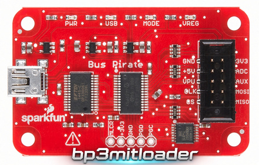
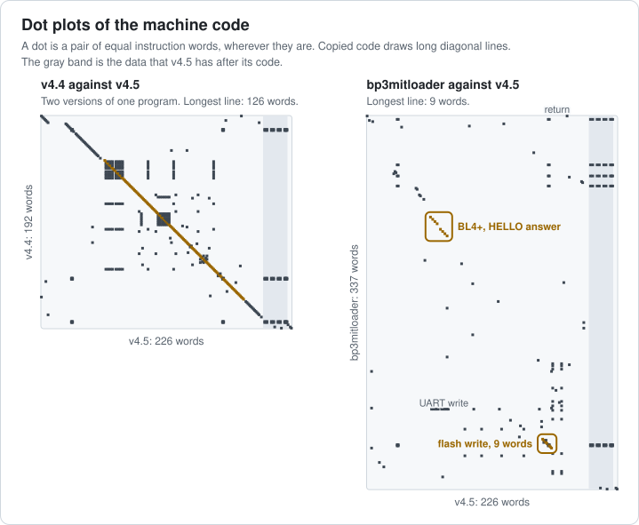
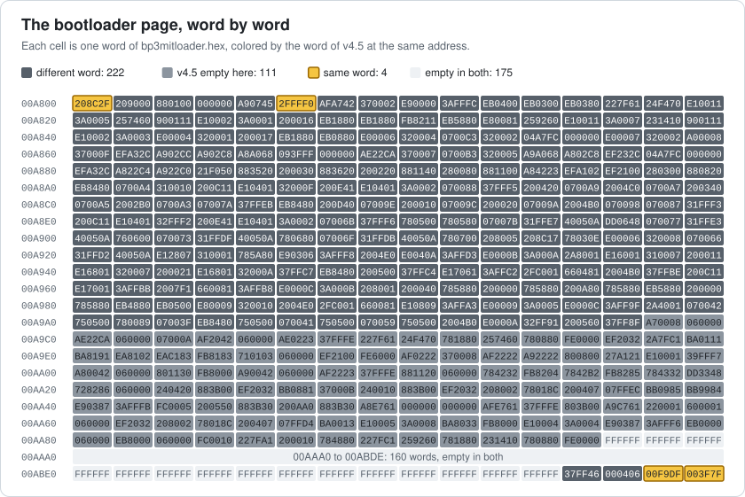
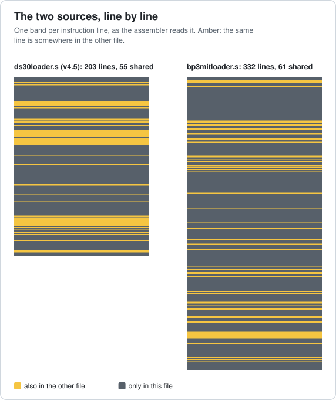
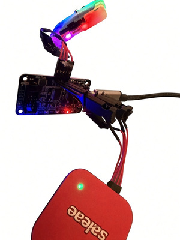

# bp3mitloader

bp3mitloader is a serial bootloader for the Bus Pirate v3 (PIC24FJ64GA002), MIT license.
pirate-loader and buzzloader use it like bootloader v4.5, over the Bus Pirate v3's own USB port. It
sits in the same flash page as v4.5, so any firmware that fits with v4.5 fits with it: the official
v5.x and v6.x and the community v7.x.



Bootloader v4.x is based on ds30 Loader, which is GPL. bp3mitloader has no code from it. The
protocol and the memory map are the same, because the tools and the firmware need them. So are some
instructions the PIC and the board need.
[Code compared with bootloader v4.5](#code-compared-with-bootloader-v45) shows this on both builds
and both sources. The Bus Pirate 5/6/7 firmware (MIT) can write bp3mitloader to a Bus Pirate
v3 through the ICSP header.

`buzzloader/` has buzzloader 3.0 for Windows, Linux and macOS, and buzzloader.py, a loader in Python
that runs anywhere. They work with bootloader v4.5 too.

## Contents

- [Files](#files)
- [Install](#install)
- [Load a firmware](#load-a-firmware)
- [Loaders](#loaders)
- [When it starts in bootloader mode](#when-it-starts-in-bootloader-mode)
- [Memory map](#memory-map)
- [Protocol](#protocol)
- [What protects the flash](#what-protects-the-flash)
- [Differences from bootloader v4.5](#differences-from-bootloader-v45)
- [Code compared with bootloader v4.5](#code-compared-with-bootloader-v45)
- [Building](#building)
- [Tested](#tested)
- [Developer setup](#developer-setup)
- [Related](#related)

## Files

| File | What it is |
|---|---|
| `bp3mitloader.s` | The whole bootloader, in XC16 assembly |
| `bp3mitloader.hex` | The build: the reset GOTO at 0x000000 and the last flash page |
| `bp3mitloader.X/` | MPLAB X project that builds it |
| `buzzloader/buzzloader.py` | Loader in Python, for any system with a serial port |
| `buzzloader/buzzloader.exe`, `buzzloader/buzzloader_*` | buzzloader 3.0 builds for Windows, Linux and macOS |
| `stuff/images/` | Pictures for this README |

## Install

Writing `bp3mitloader.hex` erases the whole chip. The Bus Pirate v3 has no firmware after that.

- Bus Pirate 5, 6 or 7: run `binmode` and pick "Bus Pirate v3 unbrick: bootloader v4.6 (ICSP)". Wire
  the ICSP header as the binmode shows.
- Any PIC24FJ64GA002 programmer, like a PICkit with MPLAB IPE: write `bp3mitloader.hex` to the whole
  chip.

With no firmware the Bus Pirate v3 waits in its bootloader, MODE LED on. No jumper needed.

## Load a firmware

Use the Bus Pirate v3's own serial port: `COMx` on Windows, `/dev/ttyUSBx` on Linux,
`/dev/cu.usbserial-x` on macOS. `python3 buzzloader/buzzloader.py --list` shows them.

```
buzzloader\buzzloader.exe --dev=COM22 --hex=BPCOMPBZ-firmware-v7.1.12.hex
./buzzloader/buzzloader_x64_linux --dev=/dev/ttyUSB0 --hex=BPv3-Firmware-v5.10.hex
python3 buzzloader/buzzloader.py --dev=/dev/ttyUSB0 --hex=BPCOMPBZ-firmware-v7.1.12.hex --enter --run
pirate-loader --dev=COM22 --hex=BPCOMPBZ-firmware-v7.1.12.hex
```

With a v7.x file buzzloader and pirate-loader stop with `ERROR [50]` at page 42, same as with v4.5.
That page holds the bootloader and the configuration words, and the file has configuration words
too. The firmware is complete by then. buzzloader.py skips page 42 and ends without an error.

If the bootloader was waiting because there was no firmware or PGC was low, it starts the new
firmware 500 ms after the last packet, once PGC reads high. After the firmware's `$` it waits until
the next reset or power cycle.

Back to the bootloader:

- `$` in the firmware. v7.x leaves a request in RAM and resets, and v5.x and v6.x jump to 0x00ABF8.
  Both work. The v6.2 and v6.3 builds in buzzpirat's `bin/oldfirm` hang on `$` before they get
  there, with v4.5 too: they wait for the UART transmit buffer to be full, not empty.
- A jumper between PGC and PGD (JP2 pins 1 and 2), then a reset or a replug. It stays in the
  bootloader while the jumper is on. A Bus Pirate 5/6/7 can hold PGC low instead.

If an upload stops halfway (cable pulled, tool closed), the bootloader waits at the next reset. No
jumper needed: run the tool again.

## Loaders

| File in `buzzloader/` | System |
|---|---|
| `buzzloader.exe` | Windows |
| `buzzloader_x64_linux` | Linux x86-64 (static) |
| `buzzloader_x32_linux` | Linux x86 (static) |
| `buzzloader_mac_arm64` | macOS on Apple silicon |
| `buzzloader_mac_x86_64` | macOS on Intel |
| `buzzloader.py` | Any system with Python 3.8 or later and pyserial |

On Linux and macOS a file can lose its execute bit on the way: `chmod +x buzzloader/buzzloader_*`.
macOS can block a program that came in a zip from the web:
`xattr -d com.apple.quarantine buzzloader/buzzloader_mac_arm64`.

buzzloader 3.0 comes from [buzzpirat](https://github.com/therealdreg/buzzpirat), with its source in
`buzzloader/buzzloader.c` there. It is a mod of Pirate-Loader for Bootloader v4, so the MIT license
of this repo does not cover those five builds.

### buzzloader.py

buzzloader.py takes the command line of buzzloader 3.0 and prints the same progress lines, so
scripts made for buzzloader work with it. It is new code, MIT license. It needs pyserial:
`python3 -m pip install pyserial`.

```
python3 buzzloader.py --list
python3 buzzloader.py --dev=/dev/ttyUSB0 --hello --enter
python3 buzzloader.py --dev=COM22 --hex=BPCOMPBZ-firmware-v7.1.12.hex --enter --run
python3 buzzloader.py --simulate --verbose --hex=BPv3-Firmware-v5.10.hex
```

| Option | What it does |
|---|---|
| `--dev=PORT` | Serial port of the Bus Pirate v3 |
| `--hex=FILE` | Firmware to load |
| `--hello` | Only asks the bootloader who it is |
| `--enter` | When the bootloader does not answer, asks the running Bus Pirate firmware for it with `$` and `y`. No jumper needed. It can't work with v6.2 and v6.3: their `$` hangs. |
| `--run` | Starts the firmware at the end (`E4`) and checks that the bootloader is gone |
| `--simulate` | Reads the file and prints what it would send. No port needed. |
| `--verbose` | Also prints every packet and the pages it skips |
| `--list` | Lists the serial ports and marks the FTDI of a Bus Pirate v3 |

What it does differently from buzzloader 3.0:

- It skips page 42, so a v7.x file ends without `ERROR [50]`. It says whether the configuration
  words in the file match the bootloader's.
- It refuses a file that starts with `GOTO 0x00A800` or has code in page 42. Such a file holds a
  bootloader too and is made for a programmer, like the `-pickit-` files in buzzpirat. buzzloader
  3.0 copies that GOTO to 0x00A7FC. After that the Bus Pirate v3 answers nothing until PGC is held
  low at a reset.
- It sends HELLO up to 3 times, so a packet that an earlier tool left halfway does not stop it.
- `--enter`, `--run` and `--list` are new. Bootloader v4.5 takes `E4` only while it waits for HELLO,
  so `--run` sends it after the 500 ms receive timeout.

## When it starts in bootloader mode

At every reset it checks, in this order:

| Condition | Result |
|---|---|
| It reset the PIC itself to start the firmware (RAM 0x27F6 = `GOFW`) | Starts the firmware |
| The firmware asked for it: RAM 0x27FC = 0x31415926 and the byte at 0x27FA is not 0 | Bootloader mode until a reset or `E4` |
| PGC (RB1) reads low through its pull-up, 1 ms after PGD (RB0) starts driving low | Bootloader mode while PGC is low |
| No firmware: the GOTO at 0x00A7FC is erased | Bootloader mode until there is one |
| Anything else | Starts the firmware, about 1 ms after the reset |

At every reset it clears its mark, the request byte and the signature. v7.x writes the signature
again when it starts. A jump to 0x00ABF8 leaves the same request as the v7.x `$` and resets.

In bootloader mode the MODE LED is on. Each time nothing arrives for 500 ms it checks again. It
starts the firmware if the firmware did not ask for the bootloader, PGC reads high and there is a
firmware. It starts the firmware through a reset, so every peripheral is in its reset state. The
clock stays at 32 MHz (FRCPLL, Fcy 16 MHz), as v4.5 leaves it.

## Memory map

| PC address | Content |
|---|---|
| 0x000000 | `GOTO 0x00A800`. A write of row 0 always keeps it. |
| 0x000004-0x00A7FA | Firmware |
| 0x00A7FC | `GOTO` to the firmware. The tool copies the file's reset GOTO here. |
| 0x00A800-0x00ABF6 | Bootloader code |
| 0x00ABF8 | `BRA` to the entry for firmware that jumps into the bootloader |
| 0x00ABFA | Version word 0x0406. The firmware shows it as "Bootloader v4.6". |
| 0x00ABFC | CW2 = 0xF9DF: FRCPLL, OSCO as RA3, primary oscillator off, I2C1 on its default pins |
| 0x00ABFE | CW1 = 0x3F7F: JTAG off, no code protection, flash writes allowed, WDT off, ICS on PGx1 |

The configuration words are the same as in v4.5. The bootloader uses RAM 0x0800-0x0901 and
0x27F6-0x27FF.

## Protocol

UART 115200 baud 8N1 (114286 baud with Fcy at 16 MHz).

| Host sends | Bootloader answers |
|---|---|
| HELLO: `C1` | `D4 01 02 4B`: device 0xD4 (PIC24FJ64GA002 for the tools), protocol 1.02, `K` |
| A packet | One byte: `K`, `N`, `P` or `V` |
| `E4` at the start of a packet | Nothing. It starts the firmware, if there is one. |
| Any other byte while it waits for HELLO | `BL4+` |

A packet is `A23:16 A15:8 A7:0 CMD LEN`, then `LEN` bytes: the data and a checksum last. The
checksum makes the sum of all the packet bytes 0 (mod 256). A is a PC address.

| CMD | Meaning | LEN |
|---|---|---|
| `01` | Erase the 512-instruction page that holds A. The erase happens right before the first row written in that page. | 1 |
| `02` | Write the 64-instruction row at A (a multiple of 0x80): 192 bytes, 3 per instruction (upper, low, high). The row is read back and compared. | 193 |

| Answer | Meaning |
|---|---|
| `K` | Done |
| `N` | Bad checksum, wrong length, row address not a multiple of 0x80, unknown command, or a row that does not go with the erase before it |
| `P` | Address outside 0x000000-0x00A7FF: the bootloader page and above |
| `V` | The row does not read back as sent, or the flash reported an error |

If the next byte of a packet takes more than 500 ms, the bootloader drops the packet and any pending
erase, and waits for HELLO again. After HELLO, a `C1` or `E4` at the start of a packet counts as
HELLO or `E4`: no address on this PIC has bits 23:16 set.

## What protects the flash

- Nothing sent to the bootloader can erase or write its page (0x00A800 and up, with the
  configuration words).
- Row 0 always starts with `GOTO 0x00A800`, so the next reset lands in the bootloader.
- A page is erased right before the first row written in it, and only if that row is in the same
  page. In page 0 that row must be row 0, so the GOTO goes back in right after the erase.
- Every upload starts with page 0 and ends with page 41, where the tools put the GOTO to the
  firmware. When page 0 is erased, page 41 is erased first. Until the upload writes page 41 again
  there is no GOTO to a half-written firmware, so the bootloader waits after any reset. A tool that
  wrote page 0 and not page 41 would leave the Bus Pirate v3 in its bootloader. pirate-loader and
  buzzloader always write both.
- Every row is read back after the write. A row is written even after a failed erase, so row
  0 always gets its GOTO. The answer is `V` then.

One gap is left: the erase of page 0 and the write of row 0 right after it, two self-timed cycles of
about 3 ms each (DS39881E, D133A). A power loss there leaves the reset vector erased, and the PIC
needs a programmer. v4.5 has the same gap. It comes from the memory map.

## Differences from bootloader v4.5

The tools and the firmware see the same bootloader: same HELLO answer, packets, checksum, answers,
`BL4+`, `E4`, 500 ms timeout, erase before the next row write, GOTO kept in row 0, RAM request,
0x00ABF8, version word address and configuration words. Same tools and files give the same words in
the firmware pages. The differences:

| | Bootloader v4.5 | bp3mitloader |
|---|---|---|
| No firmware (0x00A7FC erased) | Loops through its own start, silent | Bootloader mode |
| Upload stopped halfway | The old GOTO stays at 0x00A7FC: the PIC runs a mix of old and new firmware, and it needs the jumper | Page 41 is erased with page 0: bootloader mode |
| Jumper test | Reads PGC 2 cycles after turning on its pull-up. With wires or a probe on PGC it reads low, and every reset spends 487 ms in bootloader mode. | Reads PGC 1 ms later |
| v7.x `$` | Stays while PGC floats low | Stays until a reset or `E4` |
| Jump to 0x00ABF8 | Keeps running with the firmware's peripherals and interrupts. The v4.5 of the 2020 upgrade, and of buzzpirat's firmware and bootloader files until November 2026, checks PGC at once. If PGC is high, the firmware starts again. If PGC is low, it stays until a receive timeout finds PGC high. | Leaves the request and resets: stays until a reset or `E4` |
| Starting the firmware | Jumps with UART1 and PR1 still changed | Through a reset |
| Row after an erase of another page | Erases the row's page | `N` |
| Row 1 to 7 after an erase of page 0 | Erases page 0, and 0x000000 stays erased | `N` |
| HELLO right after HELLO | Taken as an address byte | Answered |
| `LEN` of 0 or over 193 | Writes past its 193-byte buffer | `N` |
| Address bits 23:16 not 0 | Used as TBLPAG | `P` |
| Row address not a multiple of 0x80 | Written anyway | `N` |
| Unknown command | Bit 1 picks erase or write | `N` |
| UART overrun | Stops receiving | Recovers and keeps the bytes already received |
| Last answer before starting the firmware | Can get cut | Goes out whole |
| Receive timeout | 487 ms | 500 ms |
| Version word | 0x0405 | 0x0406 |

## Code compared with bootloader v4.5

Here v4.5 is the bootloader page that the 2020 upgrade from v4.x
([`BPv3-bootloader-upgrade-v4xtov4.5_Sep-2020_USBEprom.hex`](https://github.com/therealdreg/buzzpirat/blob/99a7c3e699a03bda00e59f707263a8ffc6986c29/bin/oldfirm/BPv3-bootloader-upgrade-v4xtov4.5_Sep-2020_USBEprom.hex))
writes. buzzpirat's firmware and bootloader files had the same page until November 2026. Its code
is, word for word, what XC16 v2.10 builds from
[`ds30loader.s`](https://github.com/therealdreg/buzzpirat/blob/99a7c3e699a03bda00e59f707263a8ffc6986c29/firmware/bootloader/ds30loader.s)
with its own linker script. After the code it has 22 words of data that nothing runs, and at
0x00ABF8 it keeps the jump word of v4.4. The plain build, which the buzzpirat files carry now, and
v4.4 give the same 4 equal words and the same longest line. The figures show only words of
bp3mitloader: v4.5 shows up as colors and dots.



A dot plot puts one program on each axis and marks every pair of equal instruction words. Copied
code draws long diagonal lines, even after it moved. v4.4 against v4.5, two versions of one program,
has a line of 126 words. The longest line of bp3mitloader against v4.5 is 9 words: the flash unlock
and write sequence of the datasheet (DS39881E, Example 5-4 with the wait loop of Example 5-3). The
PIC takes no flash erase or write without it. The box marked BL4+ holds the bytes the protocol makes
both send, `BL4+` and the answer to HELLO. Both load each byte with the same `mov` to w0, and the
next word differs. The rest are single words or pairs, like `return`, `nop`, the UART write and the
configuration words. The dots in the gray band are words of the data after the v4.5 code.

By instruction names alone, with registers and values left out, the longest common run is 10: both
write the GOTO of row 0 into the row buffer byte by byte. Parts of the Bus Pirate v3 firmware, which
has nothing to do with v4.5, reach 15 that way.



The grid compares each word with the word of v4.5 at the same address. That test is weaker: code
moved by one word would differ in nearly every cell. 4 of the 512 words are the same:

| Address | Word | Why it is the same |
|---|---|---|
| 0x00A800 | `mov #0x8C2, w15` | Both keep one row and its checksum at 0x0800, the start of RAM, and start the stack right after it |
| 0x00A80A | `mov #0xFFFF, w0` | Same word, other job: bp3mitloader starts its wait for the PLL lock, v4.5 makes all pins digital |
| 0x00ABFC | 0x00F9DF | CW2, kept as in v4.5 for the firmware |
| 0x00ABFE | 0x003F7F | CW1, kept as in v4.5 for the firmware |



The sources are compared the way the assembler reads them: comments, labels, directives and code
that is not built left out, macros expanded, and every register, constant and bit name replaced by
its value. Renaming can't hide a copy that way. 61 of the 332 instruction lines of bp3mitloader.s
are somewhere in ds30loader.s, which has 203. The longest run is the flash sequence, 8 lines.

| Lines | What they are |
|---|---|
| 15 | `return` and `nop` |
| 15 | Values put in w0, nearly all bytes both send: `BL4+`, the HELLO answer, `K`, `N`, `P`, `V` |
| 10 | The flash sequence without its two nops, and the NVMCON values for a page erase and a row write |
| 10 | The pins and clock of the Bus Pirate v3: PGC (RB1) and its pull-up, PGD (RB0), the MODE LED (RA1), CLKDIV |
| 5 | UART1 at 115200 baud: the baud value, transmit on, one read and one write |
| 2 | `clrwdt` and `mov #0xffff, w0` |
| 2 | `mov #0, w0`, for another job in each |
| 2 | `clr w8` and `mov w0, w13`: the same register for the same job |

### Bootloader v4.4 and v4.5

[`BPv3-Bootloader-v4.4.hex`](https://github.com/therealdreg/buzzpirat/blob/99a7c3e699a03bda00e59f707263a8ffc6986c29/bin/oldfirm/BPv3-Bootloader-v4.4.hex)
against v4.5, instruction by instruction: the code of v4.5 keeps 183 of the 188 instructions of
v4.4, 6 of them branches with a new offset. It adds 17 and drops 5.

| | v4.4 | v4.5 |
|---|---|---|
| `E4` while it waits for HELLO | Answers `BL4+` | Starts the firmware |
| Request of the v7.x firmware in RAM: 0x31415926 at 0x27FC and a byte at 0x27FA that is not 0 | Not read | Bootloader mode, no jumper needed. 15 instructions, added to the v4.5 source in 2017 by Alessandro Gatti. |
| Jump word at 0x00ABF8 | Goes to the code that marks a jump from the firmware | The same word as v4.4. In the v4.5 code it lands on the exit test instead. |
| After the code | 4 `nop` and a `reset` that no branch reaches | 22 words of data that nothing runs |
| Version word | 0x0404 | 0x0405 |

## Building

You need Microchip XC16 (tested with v2.10).

In MPLAB X (tested with v6.35), open `bp3mitloader.X` and build. The output,
`bp3mitloader.X/dist/default/production/bp3mitloader.X.production.hex`, is the same file as
`bp3mitloader.hex`.

From the command line, with XC16's `bin` folder in PATH and `XC16` pointing to the XC16 folder:

```
xc16-as -omf=elf -p24FJ64GA002 -I "$XC16/support/PIC24F/inc" --fatal-warnings -o bp3mitloader.o bp3mitloader.s
xc16-ld -omf=elf -p24FJ64GA002 --script "$XC16/support/PIC24F/gld/p24FJ64GA002.gld" --no-ivt --no-isr --no-data-init --no-handles --check-sections -o bp3mitloader.elf bp3mitloader.o
xc16-bin2hex -omf=elf -a bp3mitloader.elf
```

On Windows that gives the same `bp3mitloader.hex` too. On Linux the records are the same, with LF
line ends. There is no vector table: the bootloader uses no interrupts, and the firmware brings its
own table in page 0.

SHA-256 of `bp3mitloader.hex`: `787dfeaf0ff8d5500ed3f1fda6ddb20f1d20f984932c544c1fa25e210bc1ff71`.

## Tested

Bus Pirate v3.5 (PIC24FJ64GA002 rev B8), October and November 2026, on Windows 11 and on native
Linux (Ubuntu 26.04). A Bus Pirate 6 wrote the bootloader, with a logic analyzer on the ICSP lines.

- The decoded ICSP traffic of the binmode: one erase of user memory and the 8 rows of
  `bp3mitloader.hex`, each written once.
- pirate-loader 1.0.2 and buzzloader 3.0, their Windows and Linux builds, loaded the official
  v5.10 r559, v6.1 r1676, v6.2 r1981 and v6.3 r2151, and the community v7.1.12. Each one showed
  `Bootloader v4.6` in `i`. `$` went back to the bootloader from v5.10, v6.1 and v7.1.12, and `E4`
  back to the firmware.
- A test firmware filled each free word from 0x000004 to 0x00A7FA (the most a firmware can use, with
  v4.5 too) with random values. It was loaded 69 times with new values (32 with buzzloader 3.0,
  31 with pirate-loader, 6 with buzzloader.py) and read back each time: none of the 22016 words
  differed, bootloader page included.
- 11000 packets with bad checksums, lengths, addresses and commands, cut packets and random bytes:
  every answer was the expected one, and the bootloader kept answering.
- 31 patterns written to RAM 0x27F6-0x27FF before a reset: every reset followed the
  [entry rules](#when-it-starts-in-bootloader-mode).
- Uploads stopped in page 20 and inside page 41, and a USB cable pulled in page 26: the bootloader
  waited after the reset, no jumper.
- 72 full rounds: the binmode wrote the bootloader, pirate-loader or buzzloader wrote v7.1.12, and
  the Bus Pirate v3 answered with it every time.
- By hand: the MODE LED, replugs with and without a firmware, and a real PGC-PGD jumper. The
  bootloader followed the entry rules each time.
- buzzloader.py, on Windows 11 so far. With `--simulate --verbose` it prints the same pages, lines
  and packets as buzzloader 3.0 for the six firmware files above (v7.1.12 in its BZ and BPCOMPBZ
  builds) and three random images. On bp3mitloader it loaded all six, with `--enter` from the `$` of
  v5.10, v6.1 and v7.1.12. On bootloader v4.5 it loaded three random images, read back with no word
  different, then v7.1.12 and v5.10, with `--enter` and `--run`.

## Developer setup



A Bus Pirate 6 on the ICSP header of the Bus Pirate v3, and a Saleae Logic Pro 8 on the ICSP lines.

## Related

- https://github.com/therealdreg/bp3unbricker
- https://github.com/therealdreg/buzzpirat
